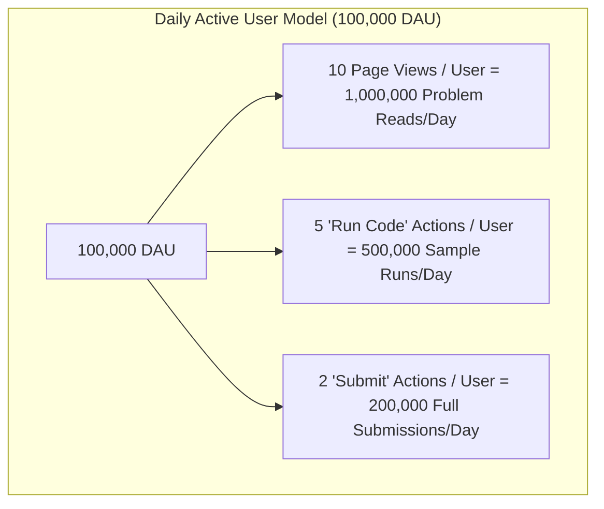
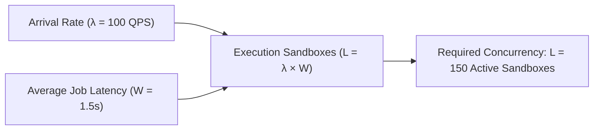
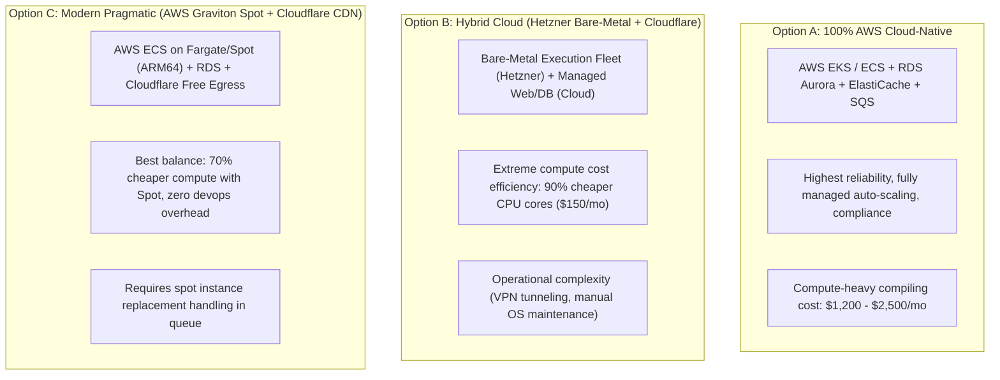

# Katasphere Capacity Planning & Back-of-the-Envelope Estimation

> **Objective**: Quantify the compute, memory, storage, throughput (QPS), and network bandwidth required to scale Katasphere from early traction to an enterprise platform serving **100,000 Daily Active Users (DAU)** with peak surges up to **50,000 concurrent contest participants**.

---

## 1. Core Assumptions & User Behavior Model

### Baseline Demographics
| Metric | Baseline (Normal Day) | Peak Surge (Weekly Contest / Live Event) |
|---|---|---|
| **Daily Active Users (DAU)** | 100,000 users | 250,000 users |
| **Concurrent Users (Peak Window)** | ~5,000 – 10,000 concurrent | **50,000 concurrent users** |
| **Catalog / Description Reads** | 1,000,000 requests / day | 3,500,000 requests / day |
| **"Run Code" (Sample Cases)** | 500,000 runs / day | 1,500,000 runs / day |
| **"Submit Code" (Grading Fleet)** | 200,000 submissions / day | 750,000 submissions / day |
| **Total Code Execution Jobs** | **700,000 jobs / day** | **2,250,000 jobs / day** |

---

## 2. Throughput & Queries Per Second (QPS)

There are 86,400 seconds in a day. However, web traffic is rarely evenly distributed. A **peak factor of 3x to 5x** applies to standard peak hours, and up to **10x** during the first 15 minutes of a scheduled live coding contest.

### Calculation Breakdown

#### A. Read Traffic (Catalog, Problem Statements, Tags, Hints)
- **Daily Volume**: $1,000,000 \text{ reads/day}$
- **Average Read QPS**: 
  $$\text{QPS}_{\text{avg}} = \frac{1,000,000}{86,400} \approx \mathbf{11.6 \text{ QPS}}$$
- **Peak Read QPS (Contest Surge, 10x factor)**:
  $$\text{QPS}_{\text{peak}} \approx 11.6 \times 10 \approx \mathbf{116 \text{ QPS}}$$
- *Architecture Impact*: Handled almost entirely by **Next.js Edge CDN + Redis Cache-Aside** (0% database load).

---

#### B. Code Execution Traffic (The Heavy Compute Pipeline)
This represents the most critical workload on the platform: running untrusted user code (compilation + grading).

- **Total Daily Executions**: $500,000 \text{ (Runs)} + 200,000 \text{ (Submits)} = 700,000 \text{ executions/day}$.
- **Average Execution QPS**:
  $$\text{Execution QPS}_{\text{avg}} = \frac{700,000}{86,400} \approx \mathbf{8.1 \text{ executions/second}}$$
- **Peak Execution QPS (Normal Evening Peak, 5x)**:
  $$\text{Execution QPS}_{\text{peak}} \approx 8.1 \times 5 \approx \mathbf{40 \text{ executions/second}}$$
- **Extreme Contest Surge QPS (50k participants in a 90-minute window)**:
  - 300,000 submissions in the first 30 minutes ($1,800 \text{ seconds}$):
  $$\text{Execution QPS}_{\text{contest}} = \frac{300,000}{1,800} \approx \mathbf{166.7 \text{ executions/second}}$$

---

## 3. Compute Sizing: The Worker Fleet (Little's Law)

To size the judge worker fleet, we apply **Little's Law**:
$$L = \lambda \times W$$
*Where*:
- $L$ = Number of concurrent execution jobs in progress.
- $\lambda$ = Arrival rate (Execution QPS).
- $W$ = Average job completion latency (compilation + execution + teardown).

### Sandbox Job Latency Profile ($W$)
- **Compile Time** (`javac` / `g++`): $0.4\text{s} - 0.8\text{s}$
- **Execution across 15–30 Test Cases**: $0.4\text{s} - 0.7\text{s}$
- **MicroVM/Container Setup & Teardown**: $0.2\text{s}$
- **Total Latency ($W$)**: **$\approx 1.5 \text{ seconds}$ average**

### Required Concurrency ($L$)
| Scenario | Arrival Rate ($\lambda$) | Job Latency ($W$) | Concurrent Sandboxes ($L$) |
|---|---|---|---|
| **Average Load** | 8.1 QPS | 1.5s | **12 active sandboxes** |
| **Normal Peak** | 40 QPS | 1.5s | **60 active sandboxes** |
| **Contest Surge** | **120 – 160 QPS** | 1.5s | **180 – 240 active sandboxes** |

---

### Hardware Sizing for Worker Fleet
Each sandbox container requires:
- **CPU**: Allocated 1 virtual core (`1 vCPU`).
- **RAM**: Allocated `256 MB` hard limit (`cgroups v2`).

At peak surge ($240 \text{ concurrent sandboxes}$):
- **Total vCPUs required**: $240 \times 1 \text{ vCPU} = \mathbf{240 \text{ vCPUs}}$
- **Total RAM required**: $240 \times 256 \text{ MB} = 61.44 \text{ GB RAM} \approx \mathbf{64 \text{ GB RAM}}$

#### Compute Node Topology
Using standard cloud compute instances (e.g. AWS `c7g.4xlarge` or `c6i.4xlarge` with 16 vCPUs, 32 GB RAM):
- **Nodes Needed at Peak**:
  $$\frac{240 \text{ vCPUs}}{16 \text{ vCPUs/node}} = \mathbf{15 \text{ compute worker instances}}$$
- **Nodes Needed at Off-Peak**:
  $$\frac{12 \text{ vCPUs}}{16 \text{ vCPUs/node}} \approx \mathbf{1 - 2 \text{ compute worker instances}}$$
- *Conclusion*: Auto-scaling group scaling from **2 minimum to 16 maximum nodes** handles 100% of the workload dynamically.

---

## 4. Storage & Capacity Planning (5-Year Horizon)

### A. Submissions Database (PostgreSQL)
- **Record Size**:
  - `id` (UUID): 16 bytes
  - `user_id` (UUID): 16 bytes
  - `problem_id` (UUID): 16 bytes
  - `language` (VARCHAR): 10 bytes
  - `verdict` (VARCHAR): 20 bytes
  - `runtime_ms`, `memory_kb`: 8 bytes
  - `source_code` (TEXT, ~2 KB average compressed): 2,048 bytes
  - `created_at` (TIMESTAMP): 8 bytes
  - Indexes & Overhead (~25%): 500 bytes
  - **Total per Submission Record**: $\approx \mathbf{2.6 \text{ KB}}$

- **Data Accumulation**:
  - Submissions per day: $200,000 \text{ submissions/day}$
  - Daily Storage: $200,000 \times 2.6 \text{ KB} = 520,000 \text{ KB} \approx \mathbf{520 \text{ MB / day}}$
  - Annual Storage: $520 \text{ MB} \times 365 \approx \mathbf{190 \text{ GB / year}}$
  - **5-Year Relational Footprint**: $190 \text{ GB} \times 5 \approx \mathbf{950 \text{ GB (~1 TB)}}$

> [!TIP]
> 1 TB over 5 years is easily managed by a single PostgreSQL instance (e.g., AWS RDS Aurora with 1 Primary + 1 Read Replica). Cold submissions older than 90 days can be tiered into S3 Glacier at $0.004/GB/mo ($4/year!).

---

### B. Problem Catalog & Test Cases (Object Storage)
- **Catalog Size**: 1,000 problems.
- **Average Test Cases per Problem**: 40 test cases.
- **Average Test Case Size**: 50 KB (accounting for large strings/matrix inputs).
- **Total Storage**:
  $$1,000 \times 40 \times 50 \text{ KB} = 2,000,000 \text{ KB} \approx \mathbf{2 \text{ GB}}$$
- *Conclusion*: Trivial volume. Stored in S3/Cloud Storage, replicated into worker node local NVMe caches on startup for instant zero-latency test execution.

---

### C. In-Memory Cache (Redis)
- **Session / Token Store**: 100,000 active JWT records $\times 200 \text{ bytes} \approx 20 \text{ MB}$.
- **Rate Limiting Tokens (Bucket4j)**: 100,000 keys $\times 100 \text{ bytes} \approx 10 \text{ MB}$.
- **Problem Catalog & Tag Cache**: 1,000 problems $\times 15 \text{ KB} \approx 15 \text{ MB}$.
- **Real-Time Contest Leaderboards (Sorted Sets)**: 50,000 users $\times 50 \text{ bytes} \approx 2.5 \text{ MB}$.
- **Total Redis RAM Needed**: $\approx \mathbf{2 - 4 \text{ GB RAM}}$ (A single `cache.t4g.small` or `cache.m6g.large` cluster is more than sufficient).

---

## 5. Network Bandwidth & Egress Calculations

### Ingress (Client to Server)
- 700,000 submissions/runs $\times 2 \text{ KB (code payload)} = 1.4 \text{ GB / day}$
- 1,000,000 page navigation calls $\times 1 \text{ KB (headers/cookies)} = 1.0 \text{ GB / day}$
- **Total Ingress Bandwidth**: $\approx \mathbf{2.4 \text{ GB / day}}$ ($0.22 \text{ Mbps}$ average, $2.5 \text{ Mbps}$ peak). Negligible.

### Egress (Server to Client)
- Problem statements & page JSON: $1,000,000 \times 15 \text{ KB} = 15 \text{ GB / day}$ (95% cached by CDN).
- Execution results: $700,000 \times 1.5 \text{ KB} = 1.05 \text{ GB / day}$.
- Static JavaScript/CSS bundles: Absorbed by CDN Edge.
- **Origin Server Egress**: $\approx \mathbf{2 - 3 \text{ GB / day}}$ ($\approx 90 \text{ GB / month}$).
- *Cost Impact*: Cloud egress bandwidth cost is virtually under \$10/month using Cloudflare or AWS CloudFront.

---

## 6. Cloud Infrastructure & Hosting Trade-Off Matrix

We evaluated three potential deployment models based on the calculated data:

### Detailed Infrastructure Comparison
| Dimension | Option A: AWS Standard (x86) | Option B: Bare-Metal Hybrid (Hetzner + AWS) | Option C: Pragmatic Cloud-Native (AWS ARM64 + Spot) |
|---|---|---|---|
| **Web / API Cluster** | 2-4x `t4g.medium` ECS | 2-4x `t4g.medium` ECS | 2-4x `t4g.medium` ECS |
| **Judge Compute** | 15x `c6i.4xlarge` EC2 On-Demand | 2x Dedicated AMD EPYC 64-Core | 15x `c7g.4xlarge` EC2 **Spot Instances** |
| **Database** | AWS Aurora Serverless v2 | AWS Aurora Serverless v2 | AWS RDS PostgreSQL Single-AZ + Replica |
| **Cache & Queue** | ElastiCache Redis + SQS | Self-hosted Redis + SQS | AWS SQS + ElastiCache Redis |
| **CDN / DDoS Protection** | CloudFront | Cloudflare Enterprise/Pro | Cloudflare + CloudFront |
| **Estimated Monthly Cost** | **\$1,800 – \$2,800 / mo** | **\$350 – \$600 / mo** | **\$450 – \$850 / mo** |
| **Maintenance Burden** | Very Low (Fully Managed) | High (Hardware failure management) | **Low (Managed AWS with Spot savings)** |

---

## 7. Strategic Architectural Recommendations

Based on the calculations, we should adopt **Option C (Pragmatic Cloud-Native with Spot Auto-scaling)**:

1. **Use AWS Graviton3 (`c7g` ARM64) with EC2 Spot Instances for the Judge Fleet**:
   - Compiling C++, Java, and running Python executes faster on modern ARM64 architecture than x86.
   - Spot instances provide a **70% discount** over on-demand pricing. Because submissions are stateless and short-lived (1.5 seconds), spot instance rebalancing events do not lose user data (the queue simply re-dispatches interrupted jobs).
2. **Use Managed SQS for the Asynchronous Submission Queue**:
   - Zero servers to manage, infinite scalability, sub-millisecond dispatching.
3. **Use PostgreSQL with Connection Pooling (PgBouncer/HikariCP)**:
   - 1 TB over 5 years is compact. PostgreSQL easily handles the transactional volume with basic indexing on `(user_id, problem_id)` and `created_at`.
4. **Use Cloudflare for Edge Caching & WAF**:
   - Eliminates egress costs and absorbs 95% of catalog traffic before it ever touches your backend servers.
