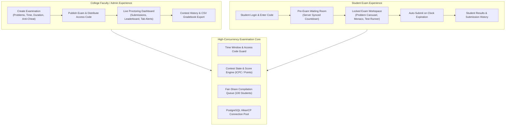
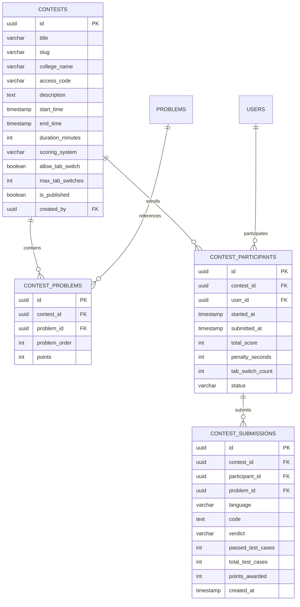
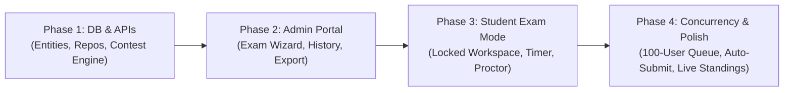

# Katasphere Institutional Coding Examination & Contest Architecture

> **Document Version**: 1.0  
> **Target Audience**: Colleges, Universities, Bootcamps & Institutional Recruiters  
> **Concurrency Target**: 50 to 100 Concurrent Exam Takers  
> **Author**: Antigravity Engineering & Architecture Team  

---

## 1. Executive Summary & Product Vision

Katasphere's Institutional Examination Platform enables colleges and universities to conduct high-stakes, time-delimited coding examinations and hackathons for **50 to 100 students simultaneously**. 

The system delivers two primary user experiences:
1. **College Administrator / Faculty Portal**:
   * Create custom examinations with specified problem counts, topics, and difficulty splits.
   * Configure exact examination time windows, durations, access codes, and anti-cheating rules.
   * View live proctoring telemetry (active students, tab-switch violations, live leaderboard).
   * Review past contest archives, student scorecards, and export results to CSV/Excel.
2. **Student Examination Environment (Locked Mode)**:
   * Accessible **strictly within the configured start and end timestamps**.
   * Pre-exam waiting room with synchronized server-side countdown.
   * Distraction-free exam workspace with problem navigation (Problem A, B, C, D).
   * Integrated Monaco code editor with real compilation against sample and hidden test suites.
   * Strict integrity enforcement (tab-switch tracking, copy-paste guards, window blur alerts).
   * Automatic graceful submission when the examination clock expires.



---

## 2. Back-of-the-Envelope Capacity Planning: 100 Concurrent Students

### A. Examination Traffic Characteristics (90-Minute Exam)
* **Total Enrolled Students**: 100 students.
* **Problems per Exam**: 3 to 4 coding questions (e.g., 1 Easy, 2 Medium, 1 Hard).
* **Average Runs per Student**: ~15 sample test runs ("Run Code") over 90 minutes.
* **Average Submits per Student**: ~5 full submissions ("Submit Code") over 90 minutes.
* **Total Executions during 90-min Contest**:
  $$\text{Total Executions} = 100 \times 20 = 2,000 \text{ compilation runs}$$
* **Average Execution Throughput**:
  $$\text{Average TPS} = \frac{2,000}{5,400 \text{ seconds}} \approx 0.37 \text{ executions/sec}$$

### B. Peak Burst Analysis (The Critical Load Moments)
In academic examinations, executions do not arrive in a uniform distribution. Traffic spikes at two distinct junctures:
1. **The 10–15 Minute Mark (First Test Runs)**: Students finish writing basic logic on Problem 1 and run code simultaneously.
2. **The Final 5 Minutes (The Last-Minute Submit Rush)**: 60% of students submit final solutions across multiple problems before time runs out.

* **Peak Concurrent Execution Rate**:
  * Assume **30 students** click "Run" or "Submit" within the same 10-second window.
  * Peak Execution TPS = $\frac{30}{10} = \mathbf{3.0 \text{ compilations/sec}}$.
* **Execution Duration**:
  * Java 21 compilation: $\approx 250 \text{ ms}$
  * Process sandbox runtime (10 test cases): $\approx 150 \text{ ms}$
  * Total turnaround per submission: $\approx 400 \text{ ms}$

### C. Compute & Thread Pool Sizing

| Metric | Required Capacity | Recommended Configuration |
|---|---|---|
| **Execution Worker Pool** | 8 concurrent execution threads | `ThreadPoolTaskExecutor(core=8, max=16, queue=100)` |
| **Max Wait Time at Peak Surge** | $30 \text{ requests} / 8 \text{ threads} \times 0.4\text{s} = \mathbf{1.5 \text{ seconds}}$ | Completely acceptable; students experience zero perceptible delay |
| **PostgreSQL DB Pool (HikariCP)** | 20–25 connections | `maximum-pool-size: 25`, `minimum-idle: 10` |
| **Server Sizing for 100 Students** | Single 4-Core, 8GB RAM Instance (e.g. AWS `c6i.xlarge` or `t4g.xlarge`) | Sufficient for Spring Boot + PostgreSQL + Next.js with ample headroom |

> [!TIP]
> **Fair-Share Compilation Queue**: To prevent a single student from spamming "Run Code" 10 times in 10 seconds and starving the queue, we implement a **token bucket rate limit per student** (e.g. max 1 run every 3 seconds per student).

---

## 3. Relational Database Schema (PostgreSQL)

To support multi-problem contests, locked time frames, real-time scoring, and proctoring logs, we introduce 4 new tables:



### Key Schema Considerations
1. **Access Code Security**: A 6-character alphanumeric code (e.g. `IIT2026`, `BITS88`) generated per contest to restrict entry to enrolled students.
2. **Server-Authoritative Timing**:
   * `start_time` and `end_time` are absolute UTC timestamps.
   * `duration_minutes` defines maximum time from when a student clicks *"Start Examination"*.
   * Expiration is calculated as:
     $$\text{Expiration} = \min(\text{started\_at} + \text{duration\_minutes}, \text{end\_time})$$
3. **Optimistic Locking & Append-Only Submissions**: Every student submit is logged as an immutable row in `contest_submissions`, preventing race conditions during live leaderboard aggregation.

---

## 4. Admin Portal Architecture (Faculty Experience)

### A. Contest Creation Wizard
Faculty members can set up an entire institutional exam in 3 intuitive steps:
1. **Step 1: Exam Metadata**:
   * Title (e.g., *"Data Structures Mid-Semester Examination 2026"*).
   * College / Department Name (e.g., *"Department of Computer Science & Engineering"*).
   * Start Date/Time & End Date/Time (calendar/time picker).
   * Examination Duration (e.g., 60 mins, 90 mins, 120 mins).
   * Access Code (custom or auto-generated).
2. **Step 2: Problem Selection & Point Weights**:
   * Search and filter from Katasphere’s curated catalog of 79+ problems (Easy, Medium, Hard).
   * Select problems with 1 click (e.g., Problem A: Two Sum [100 pts], Problem B: Longest Substring [200 pts], Problem C: LRU Cache [300 pts]).
   * Custom problems can also be authored directly.
3. **Step 3: Anti-Cheat & Examination Policy**:
   * **Tab Switch Warning**: Enable/Disable. Max allowed switches before auto-disqualification or warning flag (default: 3).
   * **Full-Screen Enforcement**: Prompt student to enter fullscreen before entering workspace.
   * **Leaderboard Mode**: Live (students see standing during exam) vs. Hidden (students only see results after the exam ends).

### B. Live Proctoring & Monitoring Dashboard
During the exam window, faculty see a real-time monitor:
* **Participant Status Grid**:
  * Total Enrolled: 84 / 100
  * In Progress: 78
  * Completed / Submitted: 6
* **Integrity Flags Table**:
  * Real-time notification if Student X switches tabs (`tab_switch_count > 3`).
* **Live Submission Stream**:
  * Instant feed of incoming submissions with verdicts (`ACCEPTED`, `WRONG_ANSWER`, `TLE`).
* **One-Click Actions**:
  * *"Extend Time by 15 Mins"* (for all students or specific student).
  * *"Force Submit Examination"* (ends the exam for everyone).

### C. Contest History & Export
* Archive of all past examinations.
* Comprehensive analytics: Median score, problem difficulty solve rates, submission distributions.
* **One-Click Export**: Download Gradebook as `.csv` with Student Name, Roll/Email, Score, Penalty, Problem-wise breakdown, and Tab Switch violations.

---

## 5. Student Examination Environment (Locked Mode)

### A. Pre-Exam Waiting Room (`/contests/[slug]`)
* If current time $< \text{start\_time}$:
  * The student sees a high-precision countdown timer synced to server time.
  * System rules, point distribution, allowed languages (Java 21, Python 3, C++ 20, JS), and anti-cheating guidelines are presented.
  * The *"Start Examination"* button is disabled until the clock strikes zero.
* Once active, entering the access code initiates the session and transitions into the locked exam workspace.

### B. Distraction-Free Exam Workspace (`/contests/[slug]/exam`)
The standard platform navigation (Navbar, sidebar, footer, pricing, external links) is **completely removed**:

```
+---------------------------------------------------------------------------------------------------------+
| [IIT Delhi - CS201 Midsem Exam]   |   Problem: [ A (100pt) ] [ B (200pt) ] [ C (300pt) ]   |   Tab Alerts: 0 |
|                                   |   Time Remaining: [ 01:24:18 ]                         |   [ Finish Exam]|
+----------------------------------------------------+----------------------------------------------------+
| LEFT: Problem Statement (A: Two Sum)              | RIGHT: Monaco Code Editor                          |
|                                                    | Language: [ Java 21 v ]         [ Reset Code ]     |
| Constraints:                                       |                                                    |
| 2 <= nums.length <= 10^4                           | class Solution {                                   |
| -10^9 <= nums[i] <= 10^9                           |     public int[] twoSum(int[] nums, int target) {  |
|                                                    |         // Candidate logic                         |
| Examples:                                          |     }                                              |
| Input: nums = [2,7,11,15], target = 9             | }                                                  |
| Output: [0,1]                                      |                                                    |
|                                                    +----------------------------------------------------+
|                                                    | BOTTOM: Testcase & Execution Results               |
|                                                    | [ Case 1 ] [ Case 2 ]   |   [ Run Code ] [ Submit ]|
+----------------------------------------------------+----------------------------------------------------+
```

### C. Anti-Cheating & Integrity Mechanisms
1. **Server-Synced Timer**: The remaining time is derived from the server timestamp received during heartbeat pings (`/api/v1/contests/{slug}/heartbeat`), preventing local client clock tampering.
2. **Tab Switch & Window Blur Detection**:
   * Uses HTML5 `document.addEventListener('visibilitychange', ...)` and `window.addEventListener('blur', ...)`.
   * When a student switches away to another browser tab or application, a prominent alert modal is displayed:
     > *"Warning: Tab switch detected! This event has been logged for your instructor (Violation 1 of 3)."*
   * An API call immediately increments `tab_switch_count` on the backend.
3. **Copy-Paste Restrictions**: Optional clipboard lockdown on the problem statement to prevent pasting into external search engines.
4. **Auto-Submit on Clock Expiration**: When the remaining time reaches `00:00:00`, all active code editors automatically trigger a final background submit and lock the workspace.

---

## 6. Implementation Architecture & Phase Breakdown



### Phase 1: Data Model & Backend Core APIs
* Create Flyway migration for `contests`, `contest_problems`, `contest_participants`, `contest_submissions`.
* Implement Spring Boot services:
  * `ContestService.java`: Lifecycle management (Create, Publish, Archive, Validate Access).
  * `ContestExecutionService.java`: Dedicated execution wrapper that records scores and penalties.
* Endpoints:
  * `POST /api/v1/admin/contests`: Create / edit contest.
  * `GET /api/v1/admin/contests`: Retrieve faculty contest archives with statistics.
  * `GET /api/v1/contests/{slug}`: Student public contest metadata and countdown state.
  * `POST /api/v1/contests/{slug}/join`: Verify access code and enroll participant.
  * `POST /api/v1/contests/{slug}/submit`: Score submission and update participant standing.
  * `POST /api/v1/contests/{slug}/tab-switch`: Record proctoring violation event.

### Phase 2: College Admin Portal (`/admin/contests`)
* Faculty contest list with status tags (`Upcoming`, `Active`, `Completed`).
* "Create Examination" step-by-step modal wizard.
* Real-time participant proctoring table with tab switch alerts.
* CSV export for university grading sheets.

### Phase 3: Student Locked Examination Environment (`/contests/[slug]/exam`)
* Pre-contest waiting room with live clock.
* Clean fullscreen examination layout with Problem Carousel (`[A] [B] [C]`).
* `useProctoring` React hook to monitor visibility and blur events.
* Auto-submit coordinator on time expiration.

### Phase 4: Concurrency Hardening & Load Verification
* Implement fair-share queue per participant in `LocalExecutionEngine`.
* Verify HikariCP database connection pooling under simulated 100-user concurrent bursts.
* End-to-end rehearsal test with sample exam session.
