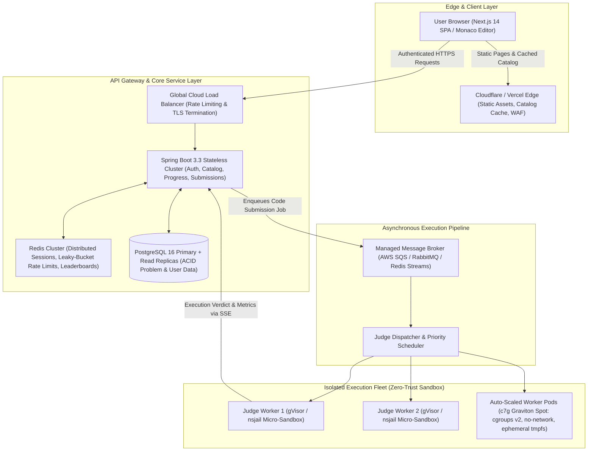
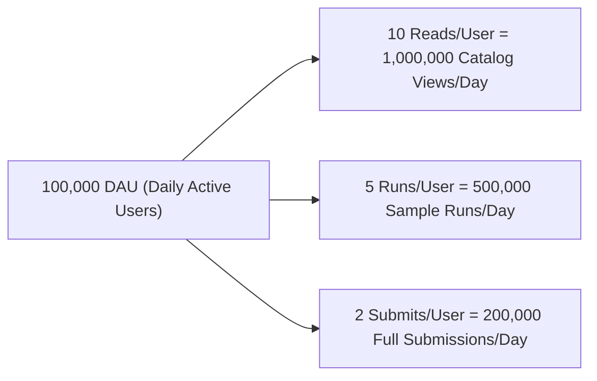
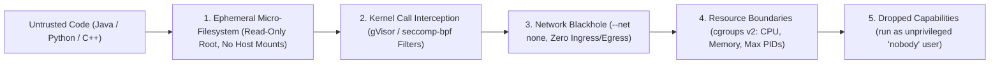
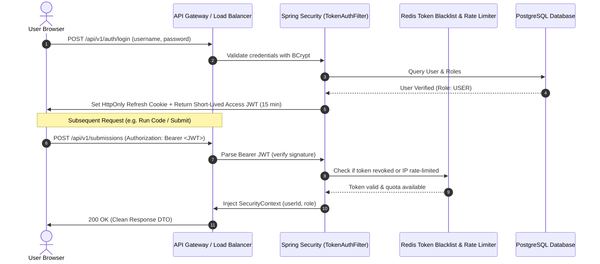
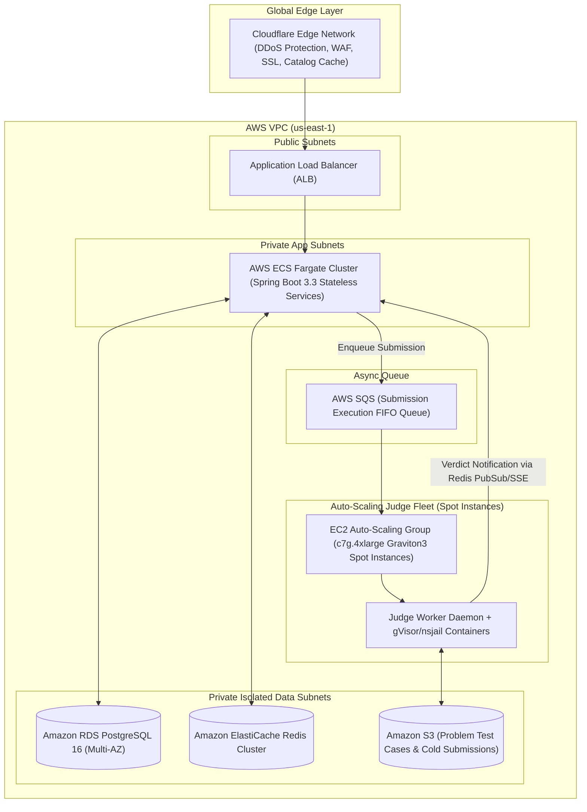
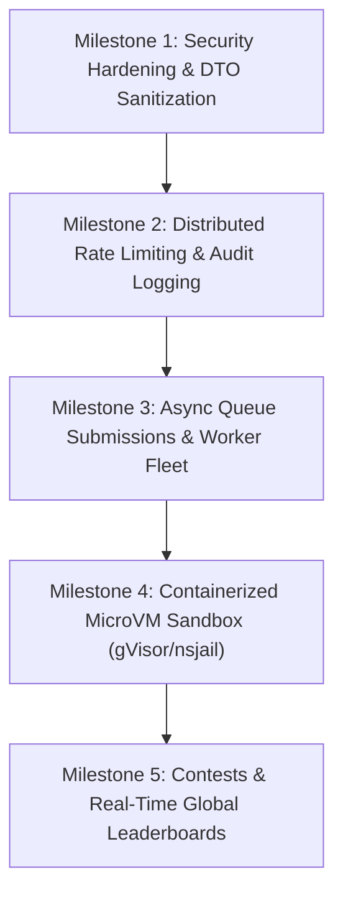

# Katasphere Master Enterprise Architecture: Scalability, Security, Capacity Planning & Infrastructure Blueprint

> **System Target**: High-throughput, multi-tenant competitive programming & algorithmic interview platform capable of serving **100,000 Daily Active Users (DAU)**, withstanding peak surges of **50,000 concurrent contest participants**, sub-second execution turnaround, zero-leakage data privacy, and mathematically verified sandboxed execution security.

---

## 1. High-Level Distributed System Topology

To scale to enterprise volumes without server degradation or host compromise, the platform strictly decouples **interactive web traffic** from **untrusted code execution**.



---

## 2. Capacity Planning & Back-of-the-Envelope Sizing

### A. Baseline Traffic & User Demographics Model


| Metric | Baseline (Normal Day) | Peak Surge (Weekly Contest / Live Event) |
|---|---|---|
| **Daily Active Users (DAU)** | 100,000 users | 250,000 users |
| **Concurrent Users (Peak Window)** | ~5,000 – 10,000 concurrent | **50,000 concurrent users** |
| **Catalog / Description Reads** | 1,000,000 requests / day | 3,500,000 requests / day |
| **"Run Code" (Sample Cases)** | 500,000 runs / day | 1,500,000 runs / day |
| **"Submit Code" (Grading Fleet)** | 200,000 submissions / day | 750,000 submissions / day |
| **Total Code Execution Jobs** | **700,000 jobs / day** | **2,250,000 jobs / day** |

---

### B. Throughput & Queries Per Second (QPS)
There are 86,400 seconds in a day. Web traffic follows a 3x–5x diurnal peak, reaching **10x** during the first 15 minutes of a live coding contest.

#### 1. Read Traffic (Catalog, Descriptions, Tags, Hints)
- **Daily Volume**: $1,000,000 \text{ reads/day}$
- **Average Read QPS**: $\text{QPS}_{\text{avg}} = \frac{1,000,000}{86,400} \approx \mathbf{11.6 \text{ QPS}}$
- **Peak Read QPS (Contest Surge, 10x factor)**: $\text{QPS}_{\text{peak}} \approx 11.6 \times 10 \approx \mathbf{116 \text{ QPS}}$
- *Architecture Impact*: Handled entirely by **Next.js Edge CDN + Redis Cache-Aside** (0% database load).

#### 2. Code Execution Traffic (Heavy Compute Pipeline)
- **Daily Volume**: $500,000 \text{ (Runs)} + 200,000 \text{ (Submits)} = \mathbf{700,000 \text{ executions/day}}$
- **Average Execution QPS**: $\text{Execution QPS}_{\text{avg}} = \frac{700,000}{86,400} \approx \mathbf{8.1 \text{ executions/sec}}$
- **Normal Evening Peak (5x factor)**: $\mathbf{\approx 40 \text{ executions/sec}}$
- **Extreme Contest Surge QPS (50k participants in a 90-min window)**:
  - 300,000 submissions in the first 30 minutes ($1,800 \text{ seconds}$):
  $$\text{Execution QPS}_{\text{contest}} = \frac{300,000}{1,800} \approx \mathbf{166.7 \text{ executions/second}}$$

---

### C. Compute Sizing: Worker Fleet via Little's Law
To determine how many execution sandboxes must run simultaneously, we use **Little's Law**:
$$L = \lambda \times W$$
*Where*:
- $L$ = Number of concurrent execution jobs in progress.
- $\lambda$ = Arrival rate (Execution QPS).
- $W$ = Average job completion latency (compilation + execution + teardown $\approx \mathbf{1.5 \text{ seconds}}$).

| Scenario | Arrival Rate ($\lambda$) | Job Latency ($W$) | Required Concurrency ($L$) |
|---|---|---|---|
| **Average Load** | 8.1 QPS | 1.5s | **12 active sandboxes** |
| **Normal Peak** | 40 QPS | 1.5s | **60 active sandboxes** |
| **Contest Surge** | **120 – 160 QPS** | 1.5s | **180 – 240 active sandboxes** |

#### Hardware Sizing for Worker Fleet
Each sandbox container requires:
- **CPU**: Allocated 1 virtual core (`1 vCPU`).
- **RAM**: Allocated `256 MB` hard ceiling (`cgroups v2`).

At peak contest surge ($240 \text{ concurrent sandboxes}$):
- **Total vCPUs required**: $240 \times 1 \text{ vCPU} = \mathbf{240 \text{ vCPUs}}$
- **Total RAM required**: $240 \times 256 \text{ MB} = 61.44 \text{ GB RAM} \approx \mathbf{64 \text{ GB RAM}}$

#### Compute Node Topology
Using standard compute instances (AWS `c7g.4xlarge` Graviton3 ARM64 with 16 vCPUs, 32 GB RAM):
- **Nodes Needed at Peak**: $\frac{240 \text{ vCPUs}}{16 \text{ vCPUs/node}} = \mathbf{15 \text{ compute worker instances}}$
- **Nodes Needed at Off-Peak**: $\frac{12 \text{ vCPUs}}{16 \text{ vCPUs/node}} \approx \mathbf{1 - 2 \text{ compute worker instances}}$
- *Auto-Scaling Policy*: Auto-scaling group scaling from **2 minimum to 16 maximum instances** handles 100% of the workload dynamically with zero over-provisioning waste.

---

### D. Storage Capacity Planning (5-Year Horizon)

#### 1. PostgreSQL Submissions Database
- **Record Size**: UUIDs (48B) + metadata (40B) + compressed source code (~2KB) + indexes (~500B) $\approx \mathbf{2.6 \text{ KB / record}}$.
- **Daily Volume**: $200,000 \times 2.6 \text{ KB} = 520 \text{ MB / day}$.
- **Annual Volume**: $520 \text{ MB} \times 365 \approx \mathbf{190 \text{ GB / year}}$.
- **5-Year Footprint**: $190 \text{ GB} \times 5 \approx \mathbf{950 \text{ GB (~1 TB)}}$.
> [!TIP]
> 1 TB over 5 years is easily handled by managed PostgreSQL (RDS Aurora Primary + Read Replica). Cold submissions older than 90 days can be moved to S3 Glacier at $0.004/GB/mo ($4/year).

#### 2. Problem Catalog & Test Cases (S3 Object Storage)
- 1,000 problems $\times$ 40 test cases $\times$ 50 KB average size = **$\approx 2 \text{ GB}$**.
- Replicated into worker node local NVMe caches on startup for instant zero-latency test execution.

#### 3. In-Memory Cache (Redis)
- Active JWT sessions (20MB) + Rate limiting tokens (10MB) + Hot problem catalog (15MB) + Live contest leaderboards (2.5MB) = **$\approx 2 - 4 \text{ GB RAM}$** total (single `cache.t4g.small` cluster).

---

### E. Network Bandwidth & Egress Economics
- **Ingress**: $700,000 \times 2 \text{ KB} \approx \mathbf{2.4 \text{ GB / day}}$ ($0.22 \text{ Mbps}$ avg, negligible).
- **Origin Egress**: $700,000 \text{ results} \times 1.5 \text{ KB} \approx \mathbf{1.05 \text{ GB / day}}$ ($\approx 30 \text{ GB / month}$).
- *Impact*: When frontend assets and problem statements are cached on Cloudflare Edge, origin egress bandwidth is under \$10/month.

---

## 3. Remote Code Execution (RCE) Security & Sandbox Model

> [!CAUTION]
> Running user-submitted code directly on the host using `ProcessBuilder` is strictly forbidden for public multi-tenant platforms. A single malicious submission could execute `System.exit()`, inspect host environment variables (`DATABASE_URL`, JWT secrets), spawn fork bombs (`:(){ :|:& };:`), or mount kernel exploits.



### Sandbox Resource Ceilings per Submission
| Constraint | Hard Limit | Enforcement Mechanism | Failure Verdict |
|---|---|---|---|
| **CPU Time** | `1.0s – 3.0s` (per testcase) | `setrlimit(RLIMIT_CPU)` + Watchdog Timer | `TIME_LIMIT_EXCEEDED` |
| **Wall-Clock Time** | `5.0s` total | Java `CompletableFuture.orTimeout` | `TIME_LIMIT_EXCEEDED` |
| **Resident Memory** | `256 MB` max | `cgroups v2: memory.max` | `MEMORY_LIMIT_EXCEEDED` |
| **Processes / Threads**| Max `64` PIDs | `cgroups v2: pids.max` (prevents fork bombs) | `RUNTIME_ERROR` |
| **Disk Output (stdout)**| `64 KB` max | Truncated pipe stream drainer | `OUTPUT_LIMIT_EXCEEDED` |
| **Network Access** | **Strictly 0 (Disabled)** | Linux Network Namespace (`--net=none`) | Security violation / socket error |
| **Host System Access**| Read-only `/lib` & `/usr`, no `/etc/shadow`, no `/proc/sys` | `chroot` / `pivot_root` mount namespace | `PERMISSION_DENIED` |

---

## 4. Frontend-Backend Contract & Data Redaction Rules

> [!IMPORTANT]
> The browser must never receive sensitive database columns, unmasked judge configurations, or proprietary benchmark datasets.

### Zero-Leakage Rules Matrix
| Component | What is Allowed to Send to Frontend | What is FORBIDDEN to Send to Frontend |
|---|---|---|
| **Problem Details** | `title`, `slug`, `difficulty`, `description`, `examples` (Sample 1 & 2 only), `constraintsText`, `tags`, starter code stubs. | **Hidden test cases**, internal test input/output datasets, validation scripts, problem author notes, database internal IDs. |
| **Run Code API** | Verdict, execution time (ms), memory (KB), standard output (`stdout`), compilation errors, sample test results. | Server file paths (e.g. `/app/...`), internal sandbox process IDs, stack traces pointing to Spring internals. |
| **Submit Code API** | Pass/fail status, testcase progress (`10/10`), runtime percentile rank, memory percentile rank. | Full text of proprietary edge-case tests (only display testcase index and minimal diff if allowed by policy). |
| **Authentication** | User profile (`id`, `username`, `email`, `role`, `avatarUrl`), short-lived access token. | `password_hash`, salt, reset tokens, Supabase service keys, database connection strings. |
| **Hints System** | Progressive hint steps (1 to 4) on demand. | The complete final source code solution (unless user has completed or explicitly requested solution unlock). |

### Strict DTO Segregation Pattern
```java
// SAFE: Public-facing DTO stripped of sensitive judge data
public record ProblemDetailDto(
    String id,
    String slug,
    String title,
    String description,
    Difficulty difficulty,
    String constraintsText,
    Map<String, String> starterCode,
    List<TagDto> tags,
    List<SampleExampleDto> examples // ONLY Examples with position <= 2
) {}

// FORBIDDEN TO EXPOSE VIA REST API:
// public class Problem {
//     private List<TestCase> allGradingTestCases; // NEVER LEAK THIS!
//     private String internalJudgeScript;
// }
```

---

## 5. Authentication, Authorization & Identity Architecture



### Role-Based Access Control (RBAC) Hierarchy
```
ROLE_ANONYMOUS
   │  Can browse problem catalog, read descriptions & sample examples
   ▼
ROLE_USER (Authenticated)
   │  Can run code against sample cases
   │  Can submit code for automated grading
   │  Can access 4-step progressive hints
   │  Can view step-by-step code visualizer
   ▼
ROLE_PROBLEM_SETTER
   │  Can author new problems & upload testcases
   │  Can define custom constraints and editorial solutions
   ▼
ROLE_ADMIN
      Can manage users, revoke tokens, view judge fleet metrics, inspect audit logs
```

---

## 6. Cloud Provider & Hosting Trade-Off Matrix

| Dimension | Option A: AWS Standard (x86) | Option B: Bare-Metal Hybrid (Hetzner + AWS) | Option C: Pragmatic Cloud-Native (AWS ARM64 + Spot) - RECOMMENDED |
|---|---|---|---|
| **Web / API Cluster** | 2-4x `t4g.medium` ECS | 2-4x `t4g.medium` ECS | 2-4x `t4g.medium` ECS Fargate |
| **Judge Compute** | 15x `c6i.4xlarge` EC2 On-Demand | 2x Dedicated AMD EPYC 64-Core | **15x `c7g.4xlarge` EC2 Spot Instances** |
| **Database** | AWS Aurora Serverless v2 | AWS Aurora Serverless v2 | **AWS RDS PostgreSQL (db.m7g.large)** |
| **Cache & Queue** | ElastiCache Redis + SQS | Self-hosted Redis + SQS | **AWS SQS + ElastiCache Redis** |
| **CDN / DDoS** | CloudFront | Cloudflare Enterprise/Pro | **Cloudflare Pro + CloudFront** |
| **Estimated Monthly Cost**| **\$1,800 – \$2,800 / mo** | **\$350 – \$600 / mo** | **\$450 – \$850 / mo** |
| **Maintenance Burden** | Very Low (Fully Managed) | High (Manual hardware maintenance) | **Low (Managed AWS with 70% Spot savings)** |

---

## 7. Recommended Target Deployment Topology (Option C)



---

## 8. Implementation Checklist & Phased Roadmap



1. **Phase 1: Zero-Leakage DTO Audit & Input Validation**:
   - Audit all Spring controller endpoints to ensure no entities or secret testcases are serialized.
   - Enforce Jakarta `@Valid` on all incoming payloads with strict bounds (e.g. max code length: 64KB).
2. **Phase 2: Redis-Backed Distributed Rate Limiter**:
   - Add Bucket4j / Spring Redis rate limiting filter to protect endpoints from automated scraping and DoS.
3. **Phase 3: Sandbox Isolation Engine**:
   - Transition `LocalExecutionEngine` to an isolated Docker/gVisor runner with non-root UID, memory caps, and `--net none`.
4. **Phase 4: Async Submissions via Queue**:
   - Decouple submission grading into an asynchronous worker pipeline with SSE streaming verdicts to the frontend.
