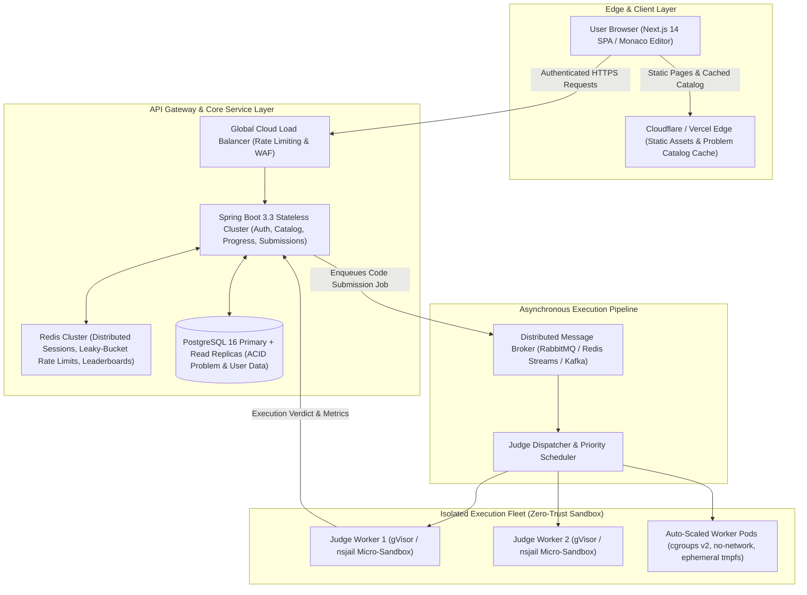
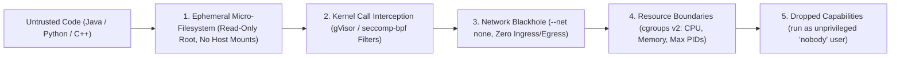
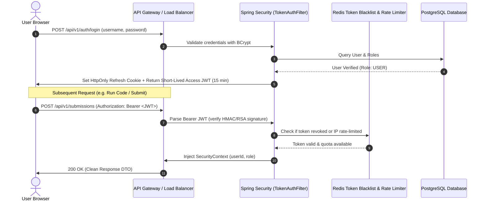
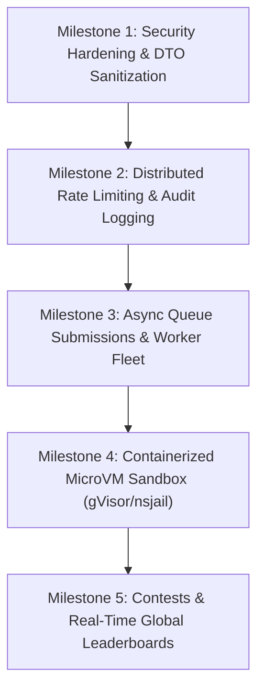

# Katasphere Enterprise Architecture: Scalability, Security & Safety Blueprint

> **System Target**: High-throughput, multi-tenant competitive programming & algorithmic interview platform capable of serving 100k+ concurrent users, sub-second code execution turnaround, zero-leakage data privacy, and mathematically verified sandboxed execution security.

---

## 1. High-Level Distributed System Topology

To scale to enterprise volumes without server degradation or host compromise, the platform decouples **interactive web traffic** from **untrusted code execution**.



---

## 2. Remote Code Execution (RCE) Security & Sandbox Model

> [!CAUTION]
> Running user-submitted code directly on the host using `ProcessBuilder` (as in prototype setups) is dangerous for public multi-tenant platforms. A single malicious submission could execute `System.exit()`, inspect host environment variables (`DATABASE_URL`, JWT secrets), spawn fork bombs (`:(){ :|:& };:`), or mount kernel exploits.

### Zero-Trust Isolation Requirements

Every untrusted execution job must strictly adhere to the **5 Layer Security Cage**:



### Sandbox Resource Ceilings per Submission
| Constraint | Hard Limit | Enforcement Mechanism | Failure Verdict |
|---|---|---|---|
| **CPU Time** | `1.0s – 3.0s` (per testcase) | `setrlimit(RLIMIT_CPU)` + Watchdog Timer | `TIME_LIMIT_EXCEEDED` |
| **Wall-Clock Time** | `5.0s` total | Java `CompletableFuture.orTimeout` | `TIME_LIMIT_EXCEEDED` |
| **Resident Memory** | `256 MB` max | `cgroups v2: memory.max` | `MEMORY_LIMIT_EXCEEDED` |
| **Processes / Threads**| Max `64` PIDs | `cgroups v2: pids.max` (prevents fork bombs) | `RUNTIME_ERROR` |
| **Disk Output (stdout)**| `64 KB` max | Truncated pipe stream drainer | `OUTPUT_LIMIT_EXCEEDED` |
| **Network Access** | **Strictly 0 (Disabled)** | Linux Network Namespace (`--net=none`) | Security violation / socket error |
| **Host System Access**| Read-only `/lib` & `/usr`, no access to `/etc/shadow`, `/proc/sys` | `chroot` / `pivot_root` mount namespace | `PERMISSION_DENIED` |

---

## 3. Frontend-Backend Contract & Data Redaction Rules

> [!IMPORTANT]
> The browser must never receive sensitive database columns, unmasked judge configurations, or proprietary benchmark datasets.

### Zero-Leakage Rules Matrix

| Component | What is Allowed to Send to Frontend | What is FORBIDDEN to Send to Frontend |
|---|---|---|
| **Problem Details** | `title`, `slug`, `difficulty`, `description`, `examples` (Sample 1 & 2 only), `constraintsText`, `tags`, starter code stubs. | **Hidden test cases**, internal test input/output datasets, validation scripts, problem author notes, database internal IDs. |
| **Run Code API** | Verdict, execution time (ms), memory (KB), standard output (`stdout`), compilation errors, sample test results. | Server file paths (e.g. `/Users/hrishii/...` or `/app/...`), internal sandbox process IDs, stack traces pointing to Spring internals. |
| **Submit Code API** | Pass/fail status, testcase progress (`10/10`), runtime percentile rank, memory percentile rank. | Full text of proprietary edge-case tests (only display testcase index and minimal diff if allowed by policy). |
| **Authentication** | User profile (`id`, `username`, `email`, `role`, `avatarUrl`), short-lived access token. | `password_hash`, salt, reset tokens, Supabase service keys, database connection strings. |
| **Hints System** | Progressive hint steps (1 to 4) on demand. | The complete final source code solution (unless user has completed or explicitly requested solution unlock). |

### Strict DTO Segregation Pattern

Never return `@Entity` models directly from Spring `@RestController`. Use immutable Java records with Jakarta validation:

```java
// SAFE: Public facing DTO stripped of sensitive judge data
public record ProblemDetailDto(
    String id,
    String slug,
    String title,
    String description,
    Difficulty difficulty,
    String constraintsText,
    Map<String, String> starterCode,
    List<TagDto> tags,
    List<SampleExampleDto> examples // ONLY Examples with position <= 2
) {}

// FORBIDDEN TO EXPOSE VIA REST API:
// public class Problem {
//     private List<TestCase> allGradingTestCases; // NEVER LEAK THIS!
//     private String internalJudgeScript;
// }
```

---

## 4. Authentication, Authorization & Identity Architecture



### Role-Based Access Control (RBAC) Hierarchy

```
ROLE_ANONYMOUS
   │  Can browse problem catalog, read descriptions & sample examples
   ▼
ROLE_USER (Authenticated)
   │  Can run code against sample cases
   │  Can submit code for automated grading
   │  Can access 4-step progressive hints
   │  Can view step-by-step code visualizer
   ▼
ROLE_PROBLEM_SETTER
   │  Can author new problems & upload testcases
   │  Can define custom constraints and editorial solutions
   ▼
ROLE_ADMIN
      Can manage users, revoke tokens, view judge fleet metrics, inspect audit logs
```

---

## 5. Enterprise Scalability Patterns

### Pattern A: Asynchronous Non-Blocking Submission Queue
- **Problem**: In prototype architectures, submitting code blocks the HTTP thread until compilation and 20 test cases complete (5–15 seconds). Under load (e.g., 500 simultaneous submissions), Tomcat worker threads exhaust, resulting in thread starvation and 504 Gateway Timeouts.
- **Solution**:
  1. Frontend submits code: `POST /api/v1/submissions`.
  2. Core backend writes submission record (`status: PENDING`), emits a message to the broker (RabbitMQ/Redis Stream), and immediately responds with `202 Accepted` (`{ submissionId: "sub_123", status: "QUEUED" }`).
  3. Frontend listens via **SSE (Server-Sent Events)** or polls `/api/v1/submissions/{id}/status`.
  4. Worker nodes consume from the queue at a sustainable, auto-scaled rate without ever stalling the web server.

### Pattern B: Multi-Tiered Caching Strategy (Cache-Aside)
- **Problem Catalog & Tags**: 99.5% read traffic, 0.5% write traffic.
  - *L1 Cache*: Next.js Edge CDN / Static generation (`generateStaticParams`).
  - *L2 Cache*: Redis cluster with TTL of 1 hour, invalidated only when a problem is edited (`@CacheEvict(value = "problems", key = "#slug")`).
  - *L3 Database*: PostgreSQL hit only on cache misses.

### Pattern C: Distributed Leaky-Bucket Rate Limiting
- **Enforcement via Redis**:
  - `POST /api/v1/submissions/run` (Run Code): 10 requests / minute per user.
  - `POST /api/v1/submissions` (Submit Solution): 5 requests / minute per user.
  - `POST /api/v1/auth/login` (Auth): 5 attempts / minute per IP (prevents credential stuffing).
  - Standard headers returned: `X-RateLimit-Limit`, `X-RateLimit-Remaining`, `Retry-After`.

---

## 6. Implementation Checklist & Next Milestones



1. **Phase 1: Zero-Leakage DTO Audit**:
   - Audit all Spring controller endpoints to ensure no entities or secret testcases are serialized.
   - Enforce Jakarta `@Valid` on all incoming payloads with strict bounds (e.g. max code length: 64KB).

2. **Phase 2: Redis-backed Rate Limiter**:
   - Add Bucket4j / Spring Redis rate limiting filter to protect endpoints from automated scraping and DoS.

3. **Phase 3: Sandbox Isolation Engine**:
   - Transition `LocalExecutionEngine` to an isolated Docker/gVisor runner with non-root UID, memory caps, and `--net none`.

4. **Phase 4: Async Submissions via Queue**:
   - Decouple submission grading into an asynchronous worker pipeline with SSE streaming verdicts to the frontend.
