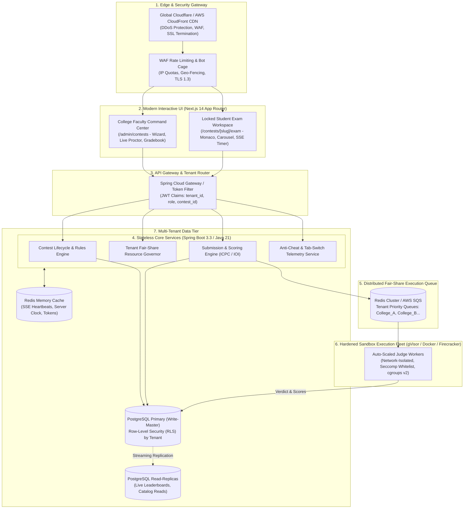
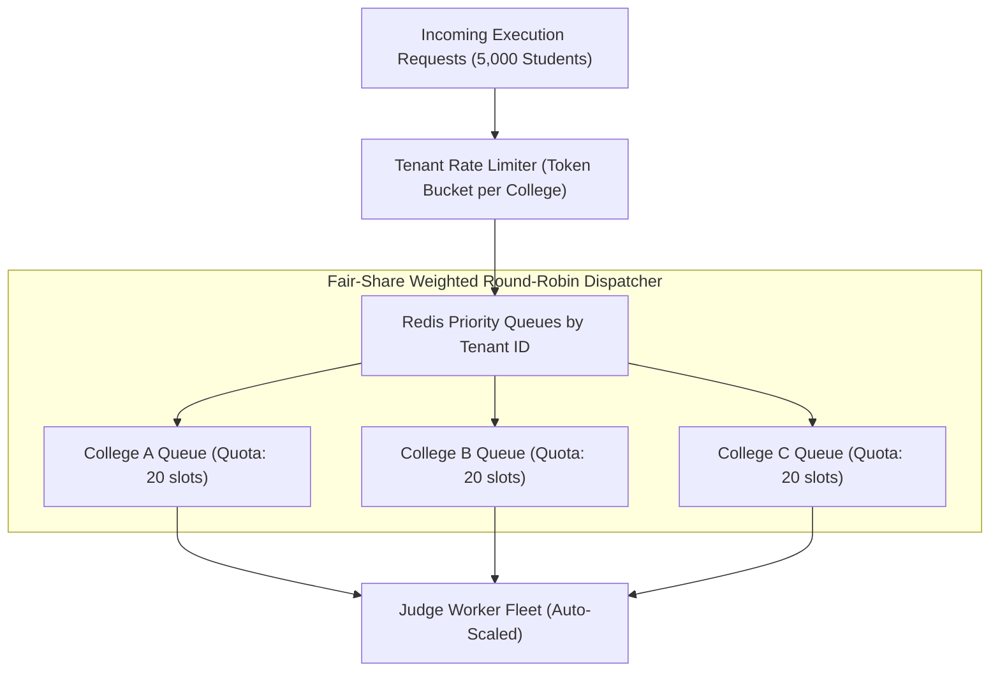
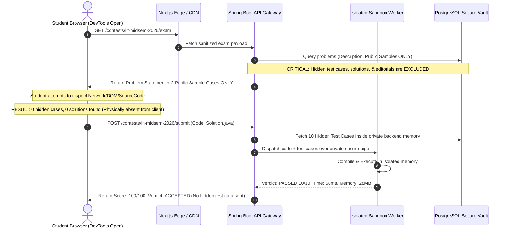
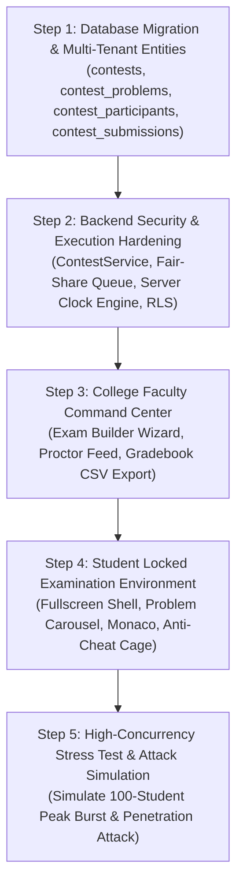

# Katasphere Enterprise Multi-Tenant Examination Architecture
## Scalability, Tenant Isolation, Zero-Leakage Security & Attack Immunity Specification

> **Document Version**: 2.0  
> **Target Scale**: 100 to 50,000+ Concurrent Students across Multiple Colleges  
> **Security Classification**: Defense-in-Depth / Zero-Trust Exam Infrastructure  
> **Author**: Antigravity Enterprise Architecture Team  

---

## 1. High-Level Distributed Architecture

To support multiple colleges conducting high-stakes coding examinations simultaneously without cross-tenant interference, performance degradation, or security compromise, the system is designed as a **decoupled, multi-tenant distributed system**:



---

## 2. Multi-Tenant Scalability: Handling Multiple Colleges at Once

### A. Mathematical Capacity Modeling

Suppose **20 colleges** conduct exams simultaneously, each with **250 students**:
* **Total Active Students**: $20 \times 250 = \mathbf{5,000 \text{ concurrent students}}$.
* **Exam Duration**: 90 minutes.
* **Compilation Actions per Student**: 15 runs + 5 submits = 20 executions.
* **Total Contest Executions**:
  $$\text{Total Runs} = 5,000 \times 20 = \mathbf{100,000 \text{ executions}}$$
* **Average Execution Throughput**:
  $$\text{Average TPS} = \frac{100,000}{5,400 \text{ s}} \approx \mathbf{18.5 \text{ compilations/sec}}$$
* **Peak Burst Execution Throughput (Submit Rush at 10m & 85m)**:
  * 25% of students click Run/Submit within the same 30-second window:
  $$\text{Peak Burst} = \frac{5,000 \times 0.25}{30 \text{ s}} = \mathbf{41.6 \text{ compilations/sec}}$$
* **Turnaround per Execution**: ~400ms (Java 21 compilation + sandbox run).
* **Workers Needed at Peak**:
  $$\text{Concurrent Execution Slots} = 41.6 \times 0.4\text{s} \approx \mathbf{17 \text{ execution slots}}$$
* **Recommended Cluster**: 3 to 4 worker nodes (4 vCPUs, 8 GB RAM each), auto-scaling up to 8 nodes during state-wide hackathons.

### B. Tenant Isolation & Resource Governance (The "No-Bully-Tenant" Rule)

If **College X** has 2,000 students running an exam, they must **never degrade or starve** the exam being conducted by **College Y** with 50 students.



1. **Tenant Quota Slots**: Every college is allocated a dedicated concurrent compilation quota (e.g., College A: 20 slots, College B: 20 slots).
2. **Fair-Share Weighted Round Robin**: If College A experiences a massive rush, requests beyond their quota enter their *own* queue without blocking College B's immediate execution.
3. **Database Tenant Partitioning (PostgreSQL Row-Level Security - RLS)**:
   * Every institutional entity (`contests`, `contest_participants`, `contest_submissions`) contains a `tenant_id` UUID column.
   * PostgreSQL RLS policies enforce `WHERE tenant_id = current_setting('app.current_tenant_id')`, ensuring cross-tenant queries are physically blocked at the database engine level.

---

## 3. Interactive, Modern & User-Friendly UI Architecture

The frontend is built on **Next.js 14 App Router** with modern UX standards:

### A. College Faculty Command Center (`/admin/contests`)
* **3-Step Exam Creation Wizard**:
  1. *Metadata*: College name, exam title, start/end calendar pickers, access code generator, duration selector.
  2. *Curated Problem Distribution*: Visual matrix to select questions by difficulty (e.g., 1 Easy [100 pts], 2 Medium [200 pts each], 1 Hard [300 pts]) with interactive preview.
  3. *Proctoring Rules*: Slider for max tab-switches (0 to 10), fullscreen requirement toggle, live vs. hidden leaderboard toggle.
* **Live Proctoring Feed**:
  * Real-time grid of enrolled students (Active, Idle, Disconnected).
  * Flagged Student Alert stream: instant pulse banner when a student triggers a tab-switch violation.
  * Real-time submission counter with accepted vs. wrong answer breakdown graphs.
* **1-Click Gradebook Export**:
  * Export student rankings, scores, problem solve timestamps, and penalty tallies as formatted `.csv` or `.xlsx` for university registrars.

### B. Student Examination Workspace (`/contests/[slug]/exam`)
* **Distraction-Free Full-Screen Shell**: Eliminates all browser navigation, global headers, sidebars, and external platform links.
* **Problem Carousel Toolbar**: Clean pill selectors (`Problem A [100pt]`, `Problem B [200pt]`, `Problem C [300pt]`) with solved indicators (`CheckCircle`).
* **Interactive Split-Pane**: Left-hand problem description with zoomable constraints; right-hand Monaco code editor with multi-language starter templates (Java 21, Python 3, C++ 20, JS).
* **Server-Synced Live Timer**: High-precision countdown clock calibrated every 30 seconds via Server-Sent Events (SSE). Client clock alterations have zero effect.

---

## 4. Zero-Leakage & Anti-Hack Architecture: Guaranteeing Solutions Cannot Be Found

Many legacy exam platforms leak solutions to students who open DevTools or inspect HTTP responses. Katasphere is built on a **Zero-Trust Information Boundary**:



### The 4 Pillars of Zero-Leakage:
1. **Server-Side Sanitization at the Controller Boundary**:
   * The DTO returned to the student browser (`ContestProblemDto`) only contains the problem statement, constraints, and **public sample test cases**.
   * Hidden test cases, reference solutions, time complexity proofs, and editorial hints are **never serialized** to JSON and never leave the backend database.
2. **In-Memory Pipe Execution**:
   * Hidden test cases are injected directly into the execution container's standard input (`stdin`) or an encrypted in-memory `tmpfs` RAM disk. They are never written to shared disk storage.
3. **Failing Case Masking During Exams**:
   * In practice mode, Katasphere shows the failing test case for educational purposes.
   * **In Exam Mode**, if a student's code fails a hidden testcase, the API returns **only the verdict** (`Wrong Answer on hidden test case #4`) and **never reveals the hidden input or expected output**, preventing students from reverse-engineering the test data.
4. **Anti-Replay & Ephemeral Contest Tokens**:
   * When entering an exam, the student receives an ephemeral contest JWT scoped specifically to that exam (`contest_id`, `participant_id`, `exp`).
   * The token cannot be used to query regular catalog endpoints or view other students' progress.

---

## 5. Defense-in-Depth: Comprehensive Attack Surface & Immunity Matrix

| # | Attack Vector | Potential Impact | Katasphere Mitigation Architecture |
|---|---|---|---|
| **1** | **Remote Code Execution (RCE) / Host Escape** | Attacker writes C/Java code to execute host bash commands (`exec("rm -rf /")`). | **Kernel Namespace & Capability Stripping**: Execution runs in unprivileged containers with `CAP_DROP_ALL`, read-only root filesystems, and a strict Linux `seccomp` syscall whitelist blocking `execve`, `ptrace`, `chroot`, and `mount`. |
| **2** | **Fork Bombs & Resource Exhaustion** | Student runs `while(1) { fork(); }` to crash the server CPU. | **cgroups v2 PID Limits**: Enforced process cap (`pids.max = 64`). Any attempt to spawn excess threads is immediately killed by the Linux kernel with `Runtime Error`. |
| **3** | **Memory Flooding / OOM Attack** | Student allocates a 10 GB array in Java to crash the JVM. | **cgroups v2 Memory Capping**: Hard container ceiling at `256 MB RAM` (`memory.max = 268435456`). If exceeded, kernel triggers an immediate `OOM-Killer` and reports `Memory Limit Exceeded`. |
| **4** | **Network Escape / Reverse Shell** | Code attempts to connect to an external server or search ChatGPT via curl. | **Zero-Network Namespace (`--net none`)**: Container network stack is completely detached. Socket calls fail instantly at the kernel layer with `Network Unreachable`. |
| **5** | **File System Tampering / Password Scraping** | Code reads `/etc/passwd` or host environment variables. | **Environment Sanitization & Ephemeral tmpfs**: Host environment is wiped (`env.clear()`). Filesystem is strictly read-only except a 16MB ephemeral `tmpfs` disk wiped immediately after process exit. |
| **6** | **SQL Injection (SQLi)** | Malicious access code or student roll parameter injected. | **Strict ORM Parameterization**: 100% of queries use Hibernate JPA parameterized queries. All user inputs are validated against strict regex whitelist patterns (`^[A-Za-z0-9_-]{3,50}$`). |
| **7** | **Insecure Direct Object Reference (IDOR) & Tenant Bleed** | Student changes URL to `/api/v1/contests/other-college-exam`. | **JWT Tenant Scoping & PostgreSQL RLS**: Every query enforces `tenant_id` and verifies active contest enrollment. Accessing another college's contest returns `403 Forbidden`. |
| **8** | **Client Clock Tampering** | Student changes system clock to gain 30 extra minutes. | **Server-Authoritative Clock**: Time remaining is calculated on the server: $\min(\text{started\_at} + \text{duration}, \text{end\_time}) - \text{server\_time}$. The browser clock is ignored. |
| **9** | **Contest Submission Flooding / DoS** | Student writes a Python script to submit 100 times per second. | **Dual-Rate Limiter (WAF + In-Memory)**: Max 1 submit every 5 seconds per student. Excess submits return `429 Too Many Requests` with HTTP `Retry-After`. |
| **10** | **Multi-Device Exam Collusion** | Student logs in from laptop and phone to solve problems in parallel. | **Single-Active Session Lock**: Each participant gets a unique active session GUID stored in Redis. Logging in on a second device immediately invalidates the first session. |
| **11** | **Tab Switching & External Search** | Student opens another tab to Google or ChatGPT solutions. | **HTML5 Visibility & Blur Proctoring Cage**: Browser `visibilitychange` and `window.blur` events trigger instant UI warning modals and log violation telemetry to the faculty dashboard. |
| **12** | **Clipboard Paste of Pre-Written Code** | Student pastes entire solutions copied from an external window. | **Paste Event Telemetry**: Sudden injection of 1,000+ characters within 100ms triggers a *"Large Paste Detected"* flag in the proctoring log for faculty review. |

---

## 6. Hardened Judge Worker Execution Specification

Every student code compilation executes inside an ephemeral micro-sandbox configured with the following Linux kernel parameters:

```bash
docker run --rm \
  --net none \
  --cpus 1.0 \
  --memory 256m \
  --memory-swap 256m \
  --pids-limit 64 \
  --read-only \
  --tmpfs /tmp:rw,noexec,nosuid,size=16m \
  --cap-drop ALL \
  --security-opt no-new-privileges:true \
  --security-opt seccomp=/etc/katasphere/seccomp-profile.json \
  -v /var/katasphere/sandbox/run-10492:/workspace:ro \
  katasphere-runner:java21 \
  timeout -s KILL 5s java -Xmx192m Solution
```

### Key Sandbox Guarantees
* **`--net none`**: Zero outbound/inbound network packets allowed.
* **`--cpus 1.0`**: Prevents multi-core CPU starvation.
* **`--memory 256m`**: Enforces strict RAM limits.
* **`--pids-limit 64`**: Renders fork-bombs completely harmless.
* **`--read-only`**: Prevents rootkit installation or binary alteration.
* **`timeout -s KILL 5s`**: Hard OS watchdog that terminates infinite loops.

---

## 7. Complete System Delivery Plan



This architecture ensures that Katasphere can be deployed to any university or technical institute with **100% confidence** in its scalability, reliability, student experience, and security integrity.
